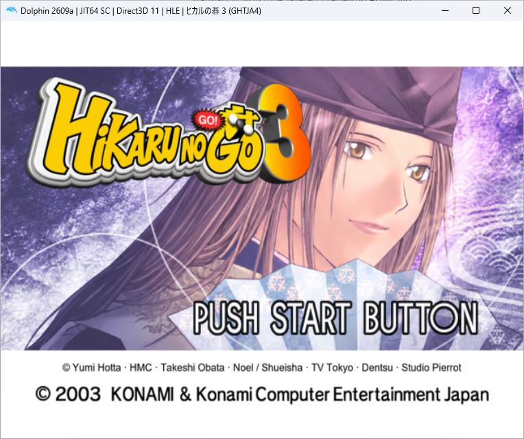
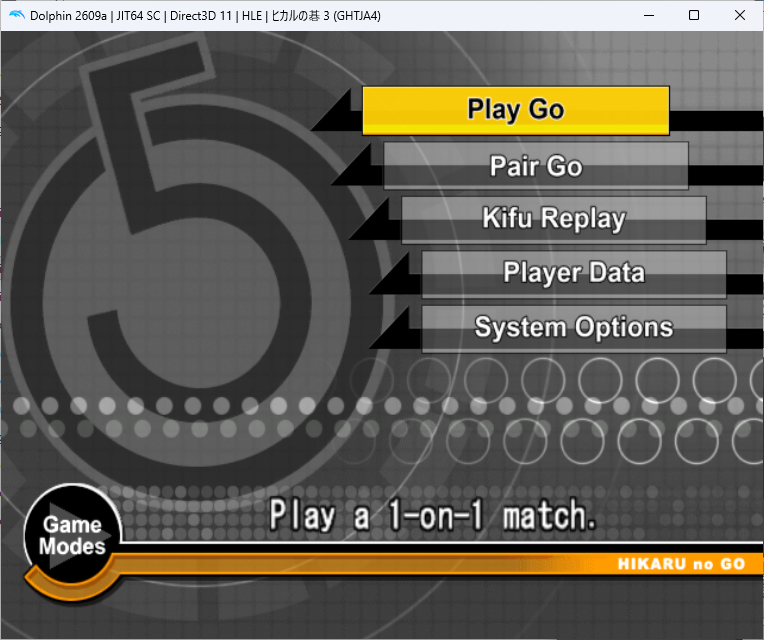
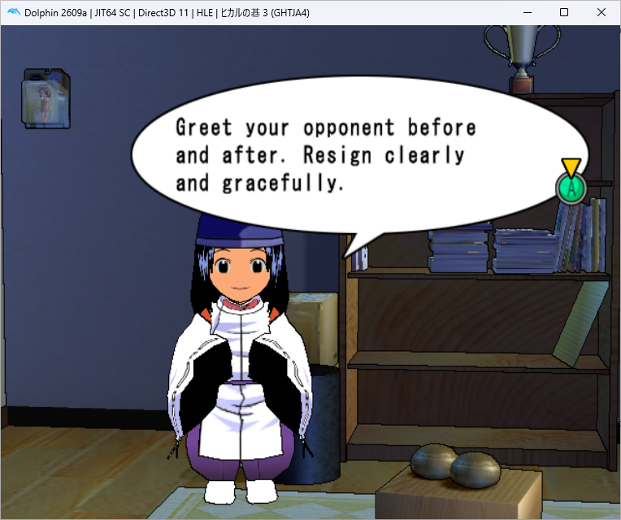
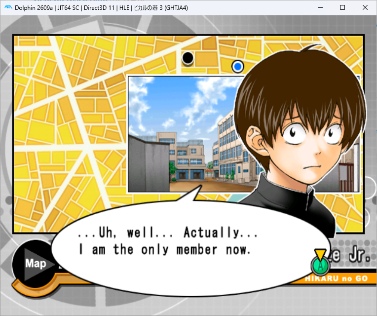
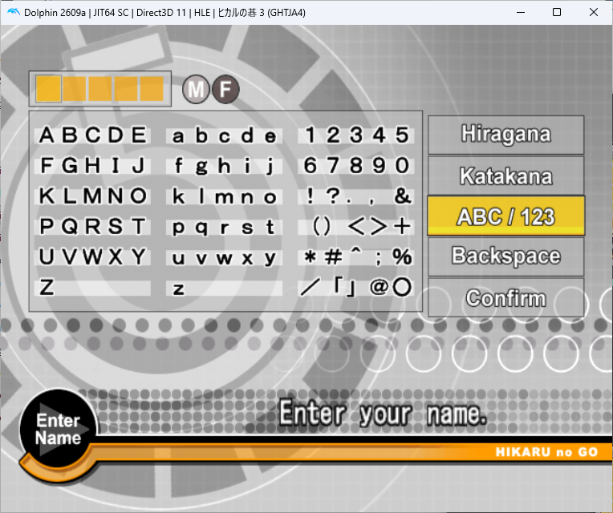
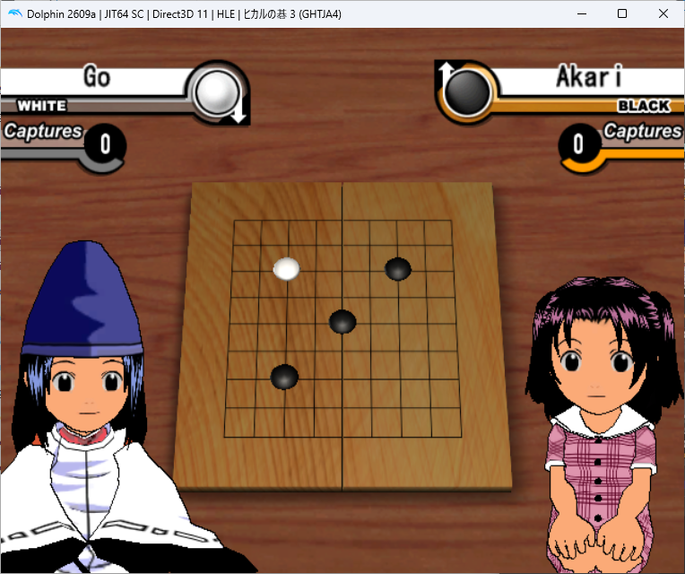

<p align="center"></p>

# Hikaru no Go 3 / ヒカルの碁3 — English translation

An English fan translation patch for **Hikaru no Go 3** — **ヒカルの碁3**
(also written **ヒカルの碁３**) — for **Nintendo GameCube / GCN**, Japanese
release **GHTJA4**. Includes editable dialogue, original development tools, a BPS
patch and a graphical Windows patcher for players who do not code.

**Version 1.0.2 (v1.0.2) — beta; broader gameplay acceptance tests are pending.**

Version 1.0.2 uses final internal build v59. It includes the v58 results-screen
spacing fixes for resignation, time, win/loss and draw labels, plus a narrowly
scoped half-point result layout correction. Scoring, komi and winner calculations
are unchanged. The maintainer reports the test build working; exhaustive gameplay
coverage remains pending. The approved Version 1.0.1 title artwork is retained. Older source filenames
record when individual components were introduced; they are retained for provenance.
This is an actively tested translation, not a claim that every optional route,
graphic or GBA download is fully verified. See QA_REPORT.json, KNOWN_ISSUES.md and
RUNTIME_CHECKLIST.md before reporting or closing a problem.

## Play

Download the Version 1 beta patch from this repository's Releases page. Extract the
release ZIP. Supply your own unmodified Japanese **GHTJA4** disc image.
For Windows, double-click **Hikaru_English_Patcher.exe** from the extracted release ZIP. Click **Browse...** to choose your Japanese ISO, then **Apply patch...** and choose a new output filename. The included BPS is selected automatically. No coding, Python or terminal is needed.

See [PATCHING_GUIDE.md](PATCHING_GUIDE.md) for full instructions. A Python option for other platforms is also included (Python 3.10+, no external packages):

```text
python project.py apply "Hikaru no Go 3 (Japan).iso" "Hikaru_no_Go_3_English_v1.0.2.bps" "Hikaru no Go 3 English v1.iso"
```

Source ISO: 1,459,978,240 bytes.
SHA-256: `c6882110afa9ef27bf49f2e0530e37c51164d5ad0c10466cb164fc1b938406fc`

Patched SHA-256:
`fe7839ca19d0fe4fedf21f552dfc742f092e28ca052342979474004b3e58ca6d`

The tool refuses a different source and existing output paths, and verifies the
finished image. Cold boot the resulting image; old emulator save states may retain
old code or graphics. Normal memory-card saves can be used. To narrow an existing
Latin player name, open the game's name editor and confirm it once. Name editing
itself retains the original wide-character display and deletion rules.

## Screenshots

Examples captured in Dolphin, provided by the project maintainer.

<table>
  <tr>
    <td><br>Title screen</td>
    <td><br>Game modes</td>
  </tr>
  <tr>
    <td><br>Room dialogue</td>
    <td><br>Map dialogue</td>
  </tr>
  <tr>
    <td><br>Name entry</td>
    <td><br>In-game match</td>
  </tr>
</table>

## Improve the translation

See CONTRIBUTING.md. `editable_text.json` contains 5,917 current verified GameCube
text-slot records, including Japanese references. Change `english`, retaining
`baseline` and metadata, then run:

```text
python project.py edit "Hikaru no Go 3 English v1.iso" editable_text.json "my-test-build.iso"
```

This conservative editor supports same-size-or-shorter CP932 text and checks
placeholders, bounds, shared slots and known bubble budgets. It deliberately
refuses unsafe expansion. GBA text and broader resource relocation use the
historical source tools described in SOURCE_GUIDE.md.

## Source and working files

The repository contains the portable patch/editor tool, editable current text,
the latest layout before/after record, QA results, source of the game-side name
conversion, and an archive of the original development Python sources and textual
working manifests. The archive preserves the development layout and is intended
for research and continued work. Historical builders depend on earlier local
builds and extracted input; they are not a one-command clean-room source build.
Exact reproduction of the released ISO is supported through the verified BPS
patch and original Japanese ISO.

No full disc image, emulator, memory-card save, account configuration, commercial
font file or extracted original game archive is included.

## Licence and attribution

Original project tools, documentation and translation contributions are available
under MIT; see LICENSE and LICENSE_SCOPE.md. Original game material and third-party
components retain their respective ownership and terms. The original game credits
remain in the game. This is an unofficial fan project, unaffiliated with the rights
holders. Contributions and corrections are welcome.


