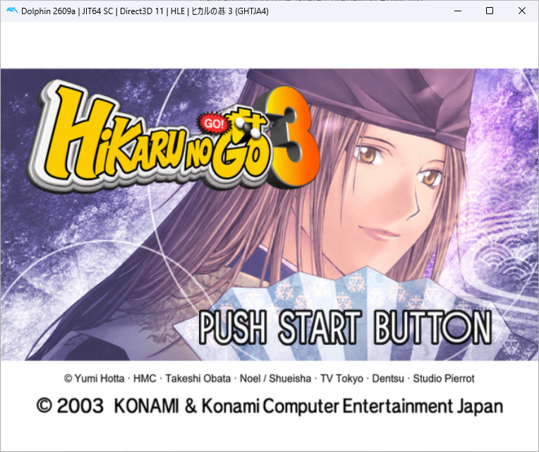
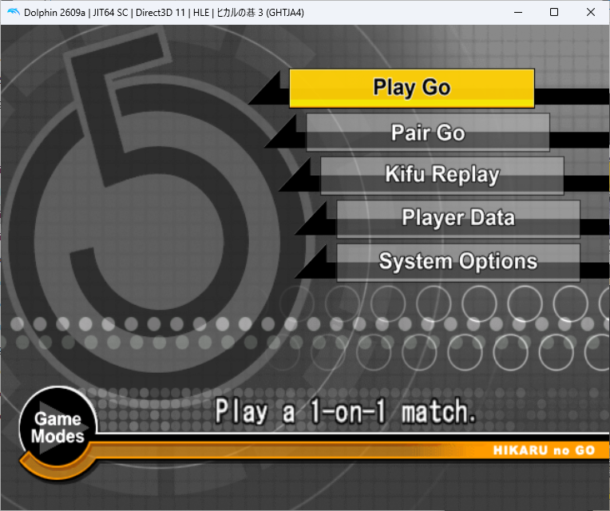
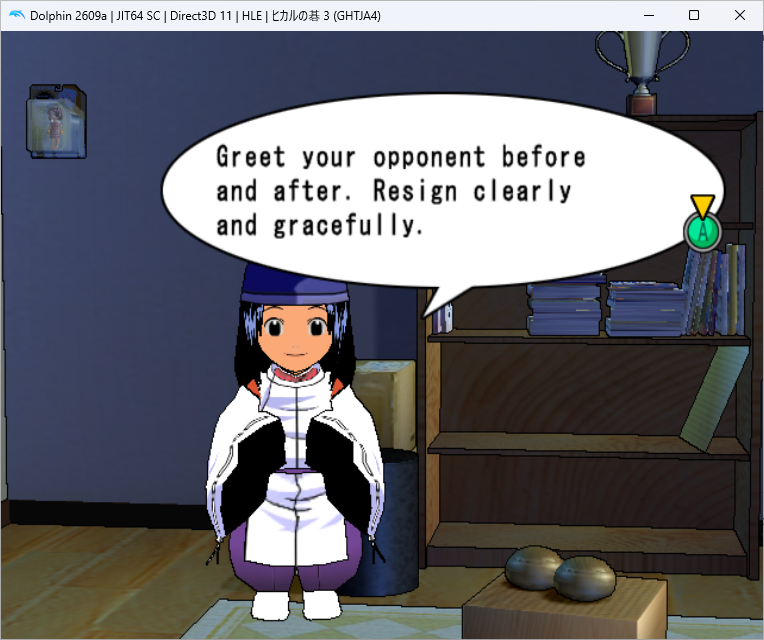
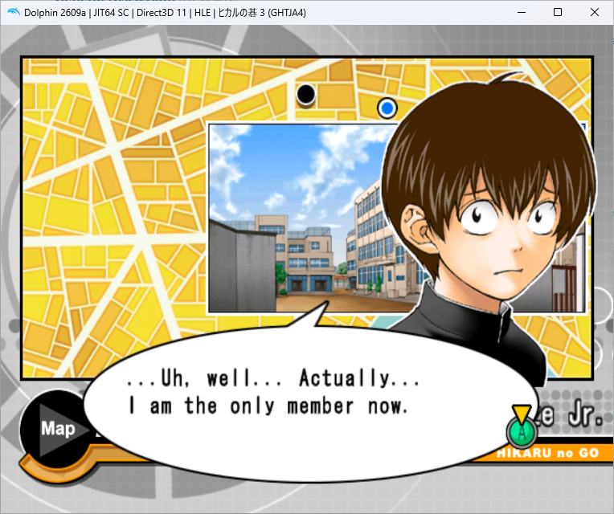
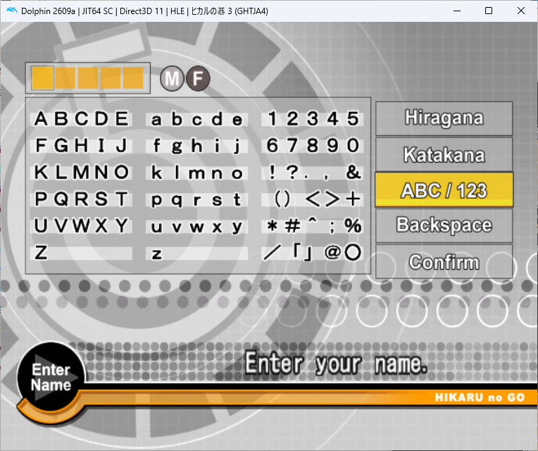
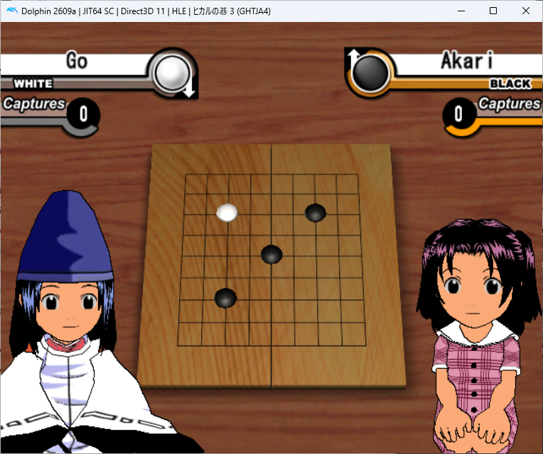

  

<h1 align="center">Hikaru no Go 3 - English Fan Translation</h1>

  Bringing the Japan-only GameCube game into English.

  <strong>v1.0.4</strong> · Nintendo GameCube · Japanese release (GHTJA4)

  <a href="https://github.com/KodakWizard/hikaru-no-go-3-english/releases/download/v1.0.4/Hikaru_no_Go_3_English_v1.0.4.zip"><strong>Download the English Patch</strong></a>
  &nbsp; · &nbsp;
  <a href="PATCHING_GUIDE.md">Installation Guide</a>
  &nbsp; · &nbsp;
  <a href="https://github.com/KodakWizard/hikaru-no-go-3-english/issues">Report a Problem</a>

---

**Hikaru no Go 3 is now pretty much fully translated into English!**

I've been working on an English patch for **Hikaru no Go 3 (ヒカルの碁3)**, the Japan-only GameCube game.

The aim was to make the whole game accessible in English while keeping the feel of the original. That means translated conversations, menus, Go matches, tutorials and plenty of little details throughout the game.

It's taken quite a few revisions to get here, particularly with all the text that was never designed to fit English. I've spent a lot of time adjusting fonts, speech bubbles, graphics and dialogue to make everything look and sound as natural as possible.

The patch is available to play right now! There are still a few areas that haven't been thoroughly tested, but I'm really happy with how it's turned out.

## Screenshots

A few screenshots from the English translation running in Dolphin. Click any image to see it full-size.

<table>
  <tr>
    <td width="50%" align="center">
      
    </td>
    <td width="50%" align="center">
      
    </td>
  </tr>
  <tr>
    <td width="50%" align="center">
      
    </td>
    <td width="50%" align="center">
      
    </td>
  </tr>
</table>

<strong>More screenshots</strong>

<table>
  <tr>
    <td width="50%" align="center">
      
    </td>
    <td width="50%" align="center">
      
    </td>
  </tr>
</table>

## Getting started

**[Download the latest English patch (v1.0.4)](https://github.com/KodakWizard/hikaru-no-go-3-english/releases/download/v1.0.4/Hikaru_no_Go_3_English_v1.0.4.zip)**

You'll need your own **legally obtained, unmodified Japanese copy of Hikaru no Go 3** for GameCube (disc ID **GHTJA4**).

### Windows installation

1. Download and extract the release ZIP.
2. Open `Hikaru_English_Patcher.exe`.
3. Select your original Japanese GameCube ISO.
4. Click **Apply patch...** and choose where to save the English version.
5. Open the newly patched ISO in Dolphin and enjoy!

That's it! No coding, Python or terminal needed.

The download also includes a standard `.bps` patch if you'd rather use another compatible patching tool.

**A couple of things to remember:**

- Always patch a clean Japanese ISO, not an older English-patched version.
- The patcher verifies your original game and the finished output.
- Your original ISO won't be overwritten.
- Start the patched game with a fresh boot rather than loading an old emulator save state. Normal memory-card saves can still be used.

For more detailed instructions, see the **[full installation guide](PATCHING_GUIDE.md)**.

## Translation progress

| Area | Status |
| --- | --- |
| English translation | **~100% of identified game text** |
| Menus and interface | Translated |
| Story and character dialogue | Translated |
| Go matches and results | Translated |
| Training and tutorials | Translated |
| English name entry | Implemented |
| Further testing | Welcome |

I've spent quite a bit of time going back over the dialogue, fixing awkward wording, adjusting speech bubbles and making sure everything fits properly.

The latest **v1.0.4** update fixes another 19 lines across Story, room conversations and matches, including a few questions that had accidentally become statements in English.

### What hasn't been fully tested?

There are still a few areas that haven't been thoroughly checked:

- Optional Story routes and less common dialogue
- Some player-name editing and save scenarios
- GBA connectivity and transfer features
- Longer playthroughs and original hardware compatibility

Some Japanese background signage and collectible packaging have intentionally been left untouched.

The translation percentage reflects the text identified and translated so far, rather than a guarantee that every possible screen and optional route has been tested.

If you come across anything I've missed, feel free to [open an issue](https://github.com/KodakWizard/hikaru-no-go-3-english/issues).

You can also check the [known issues](KNOWN_ISSUES.md) and [testing checklist](RUNTIME_CHECKLIST.md) for more details.

## Found something that needs fixing?

If you spot some strange wording, text that gets cut off, a graphical issue or anything else that doesn't seem right, please let me know.

**[Report an issue on GitHub](https://github.com/KodakWizard/hikaru-no-go-3-english/issues)**

A screenshot and a quick note about where it happened would be really helpful.

The more people who try different parts of the game, the easier it'll be to catch anything I've missed.

If you're interested in helping with the translation itself, there's also an [editable dialogue catalogue](editable_text.json) and a [contribution guide](CONTRIBUTING.md).

Please don't upload game ISOs, personal saves or emulator configuration files to issues.

## Project files and technical details

<strong>Checksums and patching information</strong>

The patch requires an unmodified Japanese GameCube ISO (GHTJA4).

**Original ISO size:**

`1,459,978,240 bytes`

**Original ISO SHA-256:**

`c6882110afa9ef27bf49f2e0530e37c51164d5ad0c10466cb164fc1b938406fc`

The patcher checks the original image before applying the translation and verifies the finished output.

If you're on another platform, you can use the included `.bps` file with a compatible patcher, or the Python patching tool included in the project.

See the [patching guide](PATCHING_GUIDE.md) for more information.

<strong>Source files and translation tools</strong>

For anyone interested in how the translation works, I've included the development tools and files used throughout the project.

These include:

- [Editable dialogue catalogue](editable_text.json)
- [Translation contribution guide](CONTRIBUTING.md)
- [Source guide](SOURCE_GUIDE.md)
- [Technical audit](TECHNICAL_AUDIT.md)
- [Known issues](KNOWN_ISSUES.md)
- [Runtime testing checklist](RUNTIME_CHECKLIST.md)

You can also download the [v1.0.4 working files](https://github.com/KodakWizard/hikaru-no-go-3-english/releases/download/v1.0.4/Hikaru_no_Go_3_v1.0.4_Working_Files.zip).

The historical development scripts are included for reference and future work, although they aren't currently a one-click way to rebuild the entire project from scratch.

## A note on AI

I've used AI tools, including ChatGPT, quite extensively while making this translation, particularly for translation work, coding and troubleshooting.

It's been a lot of back and forth rather than something that came together with a single prompt. I've gone through nearly 60 development revisions, reviewing the dialogue, testing builds, fixing things that didn't look right and gradually getting everything into a state I was happy with.

I wanted to be upfront about how the project was made, while also acknowledging all the hands-on work, testing and trial and error that's gone into it.

I'm really happy with how far the project has come, and I hope people enjoy finally being able to play Hikaru no Go 3 in English!

## Credits and licence

This is an unofficial fan translation and is not affiliated with Konami or the original rights holders.

The original game, characters, artwork and music belong to their respective owners.

Original project code, documentation and translation contributions are available under the MIT licence where applicable. See [LICENSE](LICENSE) and [licence scope](LICENSE_SCOPE.md) for details. This licence does not cover any of the original game's copyrighted material.

**No game disc image, emulator or commercial font files are included.** You'll need your own legally obtained Japanese copy of Hikaru no Go 3 to use the patch.
